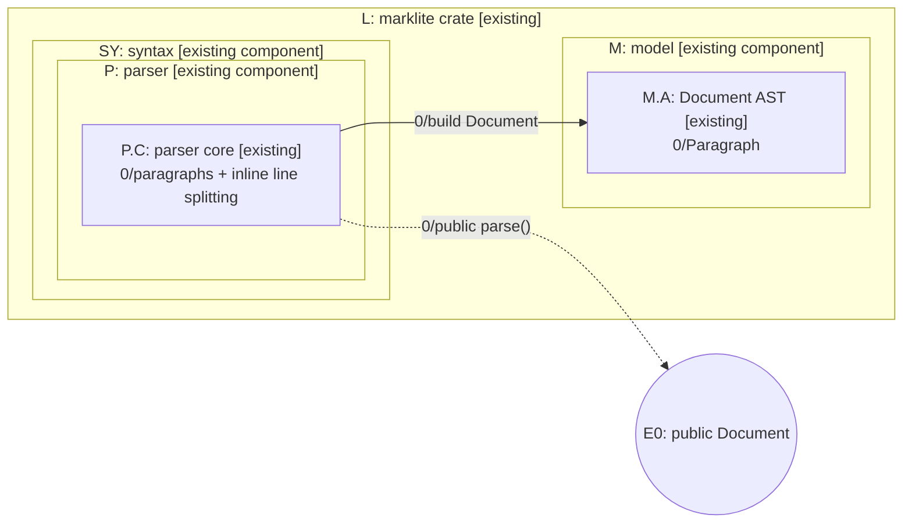
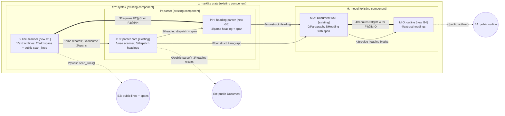
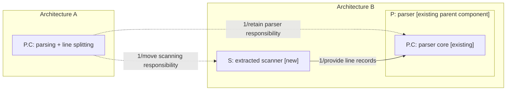

# Temporal architecture and commit-boundary review

Produce a **generation-aware architecture specification** for planning or reviewing software commits. Explain what each commit is allowed to change, what it must produce, how components and contracts evolve, and what must **not** be implemented yet. The primary deliverable is a nested architecture diagram with generation-labeled node and edge changes, backed by requirement, estimation, and verification tables.

## Non-negotiable rules

1. **Strict scope:** A generation implements only its declared requirement and necessary integration, tests, and documentation. Do not implement speculative infrastructure, cleanup, abstractions, APIs, or future features. An unused implementation for a later feature violates scope even if its future acceptance test still fails.
2. **Future features stay absent:** Check each behavior against its own introduction generation. A check for new behavior must fail for the intended missing-feature reason before introduction and pass while the behavior is required. Checks for baseline behavior must keep passing while required, including when they are part of a later feature's acceptance suite.
3. **Separate refactors from features:** An architecture-changing refactor needed by a feature belongs in an earlier generation, with existing behavior preserved. Do not mix it with feature implementation. When reviewing an already mixed history, report the actual history faithfully and propose a separate *hypothetical* split; never imply those commits existed.
4. **Trace every change:** Every added, modified, moved, or removed node and edge must be justified by a current requirement or an explicitly scoped refactor milestone. Every feature must have an observable effect or an explicitly justified, independently testable intermediate contract.
5. **Emissions are not necessarily endpoints:** An emission is a special node representing an externally observable **public contract**. It may attach to **any public component**, including an intermediate module consumed internally and independently used by external library callers. Do not force emissions through the CLI, application root, or terminal node.
6. **No fake consumption:** A new internal producer must have a real current-generation consumer, a requirement-backed public emission, or an approved large internal milestone with meaningful tests. An introduced relationship must have a real provider and consumer at that generation. Do not add dummy edges, arbitrary `pub` visibility, or trivial tests just to satisfy these rules.
7. **Feature prerequisites are explicit:** Model which component-owned feature/capability depends on which other component-owned capability, including dependencies across nested boundaries. A feature cannot consume a future-generation capability. Do not confuse *containment* with *dependency* or an architectural edge with a feature-level prerequisite.
8. **Evidence is explicit:** Mark claims as `planned`, `observed`, `verified`, or `unknown`. Never claim tests were executed, a relationship exists, or an emission is observable without evidence.

## When and how to operate

Choose the mode from the request:

- **Plan:** Given requirements and a baseline, propose a sequence of generations, their diagrams, allowed changes, contracts, costs, and acceptance tests. Estimates are predictions. Do not write implementation code unless separately requested.
- **Review:** Inspect the supplied commit range, code, tests, and relevant docs when accessible. Use one generation per actual commit in the selected linear history, record commit IDs, and compare *observed* changes against requirements. Distinguish observed behavior from verified behavior. Do not edit history, working files, or test suites unless explicitly requested.
- **Mixed:** When a plan is being checked against an implementation, preserve both the planned and observed generations, and provide a mapping between them rather than silently renumbering history.

If the history is nonlinear, state which branch/path or first-parent sequence was analyzed; do not invent an order for incomparable commits. If requirements or repository evidence are incomplete, make the narrowest reasonable assumptions, label them, and report material unknowns rather than fabricating details.

### Core concepts

- **Generation `0`:** Baseline architecture and behavior before the sequence; no new work attributed to it.
- **Generation `g >= 1`:** State immediately after the `g`th proposed or actual scoped commit. Use **1-based** generation numbers for changes.
- **Architecture epoch:** A run of generations under the same major decomposition and responsibility ownership. A significant move, split, merge, or interaction-model replacement may start a new epoch.
- **Component node:** A module, package, subsystem, or other coherent unit. **Any component may itself contain components, recursively**; a parent is a real component with possible interfaces and local changes, not merely a decorative diagram group. Use hierarchical containment for ownership only. Preserve stable IDs across moves when the component's responsibility persists. Reference children with paths such as `SYNTAX.PARSER.HEADING`, but do not conflate location with permanent identity.
- **Component-owned feature/capability `F`:** An independently identifiable behavior or contract supplied by a component, e.g. `F2@SYNTAX.SCANNER: positioned-lines`, first available at generation 2. One requirement may require coordinated features in multiple components in the **same** generation. Do not pretend a feature is implemented solely by a parent when its children perform the work.
- **Feature-dependency edge:** A requirement-level prerequisite `provider-feature => consumer-feature`, distinct from a runtime API/data edge and from nesting. Record the first generation that uses the dependency, the feature IDs, the reason, and the concrete contract path. The dependency stays active while the consumer relies on it. Annotate later changes to the provider, required contract, or path, and record when the dependency ends. Dependencies may cross sibling, parent-child, or different-depth component boundaries.
- **Relationship edge:** A directed provider/consumer contract: call, import, data, event, protocol, trait implementation, or other dependency. Name the provided capability and consumer expectation; show version changes on the edge. Use ports if a component pair has independently evolving contracts.
- **Emission node:** A special observable-contract node linked to a public component **at any nesting depth**, not necessarily a graph sink or runtime data endpoint. Examples: public library function/type/trait, CLI behavior, service endpoint, emitted event, persistent side effect, or measurable nonfunctional property. Emission links are **observability annotations**, not necessarily runtime dependency edges.
- **Internal probe:** A testable internal contract, distinct from an external emission. Justify an otherwise unused large producer only if its internal milestone is necessary, bounded, and independently testable.
- **Requirement `R_i`:** The behavioral, architectural, or nonfunctional obligation assigned to generation `i`.

The expected evolution is `A_0 -> A_1 -> ... -> A_n`, with `A_g` containing nested components, relationships, component-owned capabilities, feature prerequisites, and emissions. A node/edge may be added, changed, deleted, moved, split, or merged. Annotate actual *changes*, not mere usage of an unchanged component.

## Workflow

### 1. Establish requirements and baseline

- Identify the baseline commit or architecture; existing public behavior; existing components and interfaces; and the desired features, fixes, refactors, performance constraints, and compatibility obligations.
- Assign requirement IDs (`R1`, `R2`, ...), each with acceptance criteria and **explicit exclusions**. Map each requirement to exactly the generation where it first becomes required. Separate necessary architecture migration from feature behavior.
- Identify independent external users, including downstream crates, API clients, CLI users, event subscribers, and persisted-data readers. Never assume all observations occur at a terminal output.
- Identify **component-owned capabilities** required by each feature, not just the top-level user-visible requirement. Identify prerequisites that already exist at G0 and ones introduced in earlier generations. Record the actual provider and consumer at the lowest useful component level.

### 2. Define the generation sequence

For each `g >= 1`, record:

- `g/short-name`, type (`refactor`, `feature`, `fix`, or explicitly nonfunctional), requirement IDs, and motivation;
- allowed changes and **forbidden premature changes**;
- required new or altered public emissions, or the behavior-preserving obligation for a pure refactor;
- internal consumers, independently verifiable intermediate milestones if any, and acceptance-test obligations;
- dependencies on earlier generations, including **which provider component and specific capability** each newly introduced consumer capability requires, and why the dependency cannot be delayed or moved earlier.
- same-generation feature slices spanning multiple components: required provider, consumer, interface wiring, and public emission; treat the entire slice as one scoped feature when separately committing its pieces would create dormant code.

Do not create placeholder code for upcoming generations. If a change is useful only in a future generation and is small enough to integrate then, move it there. If a large producer must be separate, explicitly define and justify its internal milestone; otherwise group it with its first consumer.

### 3. Draw a nested, temporal architecture graph

**Every delivered architecture diagram must:**

- Show **recursive component nesting**, with **existing versus new** status at **each** level. A parent component may own code, ports, and changes in addition to its children; do not draw it only as a layout decoration.
- Give **each changed component at every depth** a stable, readable ID and list its **direct/local** generation-labeled changes as `g/short-description`; show `0/baseline` for unchanged existing components where helpful. A child change does **not** automatically count as a parent change: annotate a parent only if its own boundary, contract, dispatch, export, or implementation changes. Optional parent rollups are summaries, never duplicate work estimates.
- Name each changed **runtime/API relationship** edge with `g/short-contract-change`, its direction, and the provided/required API or protocol. Identify removed edges as well as introduced ones.
- Show **inter-component feature dependencies**, including prerequisites introduced in earlier generations, as a distinct edge type with `g/requires F_i@provider -> F_g@consumer` or a separate keyed dependency overlay when the graph is dense. Record the **actual API/protocol path** realizing each dependency. For an indirect relationship, explicitly name the intermediate consumers; never invent a direct runtime call.
- Show cross-boundary dependencies at the **lowest meaningful component endpoints**, including child-to-child links across parents and parent-to-child links. Containment alone is not evidence of a required/provided capability. Aggregate connections to a parent only when the parent owns the actual facade/contract.
- Show emissions as distinct nodes connected to the components that expose them, **including nested public components**. Public library components may emit directly *and* have outgoing edges to internal consumers. If a nested component becomes externally reachable only through a parent re-export or registration, annotate and cost that parent-boundary change instead of pretending exposure is free.
- Cover all changed components and edges; show enough unchanged neighboring architecture to understand integration. Collapse irrelevant areas rather than drawing the entire repository.
- Include a **per-generation change-size estimate for each changed node and edge**, either in the diagram or in a keyed table. Use readable IDs with detailed descriptions outside the diagram when labels grow crowded.

Default to Mermaid `flowchart` with `subgraph` nesting and labeled arrows. Use **solid `-->`** arrows for runtime/API edges, **thick `==>`** arrows for feature prerequisites, and **dashed `-.->`** arrows for public-emission annotations (except in separate migration diagrams); explain the legend. If dense, place feature prerequisites in an additional small overlay diagram keyed to the same component IDs instead of dropping them. Avoid assuming a dependency's arrow direction: state *which side provides what and which side requires it*. One logical contract may be shown as one directed edge even if runtime data also flows back as a return value.

### 4. Assess graph health at every generation

Check the *state at generation `g`*, not only the final diagram:

1. **Feature observability:** Each new feature changes a requirement-backed public emission, potentially an existing emission's semantics. A library API exposed on an intermediate node counts. A pure architecture refactor instead preserves emissions.
2. **Producer/use completeness:** Every new capability is currently consumed, externally exposed by requirement, or justified as a large tested internal milestone. Flag speculative generalization and dormant code.
3. **Consumer/interface completeness:** Every new provider-to-consumer contract has both sides present and integrated in the same generation. Do not introduce an input edge whose consumer is deferred.
4. **Temporal isolation:** No future requirement's implementation or public behavior is introduced early, even if future tests happen not to pass.
5. **Behavior preservation:** Existing emissions remain compatible unless the current requirement explicitly changes them. For refactors, require equivalent observable behavior, including relevant error, side-effect, and performance contracts.
6. **Public compatibility:** Identify breaking library API/ABI, wire-protocol, serialization, or persisted-format changes. Public types and traits can be externally observable contracts even when no program output changes.
7. **Feature dependency integrity:** When a consumer first requires a capability, verify that its provider is available with the required semantics and that the consumer uses it through a real contract path. Provider and consumer capabilities introduced together must both be complete in that commit. Recheck affected active consumers whenever the provider, contract, or path changes, including changes to intermediate components. Detect feature-dependency cycles; group inseparable same-generation capabilities into one feature slice rather than inventing temporal ordering. Dependencies on later generations are scope/order violations.
8. **Reachability and containment:** Check owner boundaries, misplaced responsibilities, cycles, duplicated interfaces, and unneeded abstractions. A parent owning a child **does not** imply the parent depends on every child feature, or vice versa. Do not mistake a test hook or private debug output for a public emission.
9. **Hierarchical completeness:** Validate each child change, parent-local change, and cross-boundary feature path. An emission from a nested public component is valid; verify any needed public exposure through enclosing components. Do not double-count changes or invent changed parent nodes just because descendants change.

Treat graph-health heuristics as findings to verify, not proofs: dynamic dispatch, plugin registration, callbacks, and external users can obscure consumers.

### 5. Verify commit-to-test evolution

Build a matrix of behavior checks against generations `0..n`. Give each row its own expected result, even when several checks belong to the same acceptance suite.

- Baseline checks **pass** from G0 for as long as the behavior is required. New behavior checks **pass** starting at the generation that owns the change, barring explicitly documented supersession.
- Before the owning generation, checks for new behavior **fail for the intended missing-feature reason**. A failing assertion for new behavior does not change the expected result of baseline assertions in the same suite.
- Pure refactors keep existing tests green and, when relevant, use differential/golden/compatibility tests to demonstrate behavior preservation.
- Negative tests must also forbid premature behavior, not merely check that a later implementation is incomplete. Structural review is required because unused future code can escape behavioral tests.
- For external library APIs, include downstream-consumer compilation tests; an API's preintroduction compile failure may be expected. For public behavior, test its semantics, not just symbol presence.
- For each cross-component dependency, pair a **contract check** with evidence of the **actual consumer path**. Test the behavior the consumer needs, including relevant metadata, errors, lifetimes, or protocol version. Trace the calls or wiring to confirm the consumer obtains the capability from the named provider. In a plan, specify what to inspect and test once the wiring exists.

To verify historical revisions, run future acceptance suites against earlier checkouts in **temporary, isolated worktrees** or equivalent harnesses, without modifying the user's working tree or committing failing tests. Separate environmental/setup failures from genuine expected failures. If tests cannot be run, report the predicted matrix as `planned` or `unverified`, never `verified`.

### 6. Handle architecture epochs and mixed history

Keep a single cumulative diagram only while the major component decomposition remains interpretable. If architectural ownership/topology changes substantially:

1. Draw a **changed-part architecture diagram for each epoch** (before and after), each with its own generation annotations.
2. Draw **one migration diagram** mapping old components/responsibilities/interfaces to new ones. Distinguish migration arrows from runtime relationships. Describe removals and split/merge mappings explicitly.
3. Place architectural refactor generations **before** feature generations they prepare; the refactor commits must preserve existing public behavior.
4. For already mixed commits, label them as scope violations and show a proposed split separately. Preserve actual commit IDs and actual generation order; do not rewrite history implicitly.

A small local cleanup does not automatically need a new epoch; the trigger is a material responsibility-boundary or interaction-model change.

### 7. Estimate changes and issue findings

- Estimate **node size** as **direct/local** implementation changes at that component, excluding child implementation and interface wiring. For a nested component, a parent total may be shown as an **optional rollup**, clearly separated from local cost.
- Estimate **runtime/API edge size** as contract definitions, adapters, and call-site integration, excluding node internals. Count removals and rewiring, not only added code. **Feature-dependency edges are semantic constraints, not extra implementation**: report `0 additional LOC (accounted for by concrete edges/nodes)`, plus risk if relevant, rather than counting their implementation twice.
- Estimate tests separately. Use ranges (e.g. `~15–25 LOC`) and optional risk/confidence, and avoid double counting. Actual code review may additionally report measured diff sizes, identified as actual rather than estimated.
- Flag each issue with `violation` / `risk` / `unknown`, generation, relevant node/edge/requirement IDs, evidence, and a minimal corrective action (move/split/remove/complete). Do not propose unrelated cleanup.

## Output contract

In Plan mode, put an explicit as-of date (`YYYY-MM-DD`) at the top of every
delivered plan, including provisional plans. Use the date the plan was prepared
or last substantively revised. Tie any relative timing to a stated date or
milestone.

Produce, in this order (condense only if a section is truly inapplicable):

1. **Scope and generation plan:** Baseline, `R_i` IDs, each `g/short-name`, category, requirement, observable result or refactor invariant, and excluded changes.
2. **Architecture diagram(s):** Recursively nested, temporal, labeled component-and-contract graph with **public emissions at any exposing node** and **cross-component feature-dependency arrows** (or an additional keyed overlay diagram for readability). Include a legend and readable IDs.
3. **Node/edge change ledger:** Per-generation local changes at all component depths with node and runtime/API edge size estimates, contract descriptions, and existing/new/moved/removed status. Include parent rollups only when clearly marked; include tests separately.
4. **Inter-component feature-dependency ledger:** `consumer feature@component -> required provider feature@component`, provider availability, generations in which the dependency is active, actual contract path across nested boundaries and any changes to it, dependency rationale, and the evidence for contract behavior and consumer use. Separate semantic dependency cost from implementation cost.
5. **Emission and traceability table:** `requirement -> node/edge changes -> emission/internal milestone -> tests`. State which public component exposes each emission.
6. **Test-evolution matrix:** Expected and, when available, actual pass/fail results across generations. Annotate failure reasons and evidence status.
7. **Architecture transition package:** Per-epoch changed-part diagrams and a migration diagram when the architecture changes substantially.
8. **Findings and boundary decisions:** Violations, uncertainty, proposed changes to commit boundaries, and a final assessment of **architecture health separately from commit-sequence health**.

For a planning task without a repository, mark diagrams and test matrices as **proposed**. For a historical review without executed tests, never present a predicted matrix as observed results. Avoid inventing module names, contracts, or LOC measurements as if they were inspected facts.

## Required worked example: a nested Rust parsing library

This **illustrative plan** demonstrates recursive components, public emissions from nested/nonterminal components, and **feature dependencies between different component-owned capabilities**. No real repository or test execution is implied.

### Generations and feature ownership

| Gen | Name | Type | Required result and owned capability | Forbidden early work |
| --- | --- | --- | --- | --- |
| 0 | `0/baseline` | Existing | `F0@P.C`: parse paragraphs into `Document` | — |
| 1 | `1/extract-scanner` | Refactor | Extract private line scanning from `P.C` into sibling `S`; `parse()` remains equivalent | No public scanning, positions feature, or headings |
| 2 | `2/positioned-lines` | Feature | `F2@S`: public `scan_lines()` yields lines **with source spans** | No heading interpretation or outline API |
| 3 | `3/headings` | Feature | `F3@P.H`: parse `# Title` into a heading **with span**; `F3@M.A`: represent heading blocks | No outline extraction or unrelated syntax |
| 4 | `4/outline` | Feature | `F4@M.O`: public `outline(&Document)` derives heading entries from the AST | No unrelated document analysis |

The **G3 parser feature depends on G2's positioned-line capability in `S`**, and **G4's outline feature depends on G3's heading representation in `M.A`**. These are two separate inter-component feature prerequisites. G2 remains independently useful to external library callers; G3 must not be smuggled into G2 as preparation.

### Architecture A: generation 0

### Architecture B: generations 1–4

Every `subgraph` labeled as a component is **a component in its own right**, recursively containing other components. The root `L` owns public re-export changes; nested `S` and `M.O` independently expose public emissions. Unchanged parents are not automatically marked changed because children change.

Legend: `-->` runtime/API contract (producer to consumer); `==>` **feature-level prerequisite**, not an additional runtime call; `-.->` emission annotation, **not** necessarily a terminal runtime data flow. Containment (`subgraph`) is ownership, **not** an implicit dependency. The `S ==> H` feature dependency is implemented by the real `S --> P.C --> P.H` path; it does not claim `H` directly calls `S`.

### Migration diagram: architecture A → B at G1

In this diagram only, dashed arrows mean **responsibility migration**, not emissions. The extraction moves code, not public behavior. The newly extracted scanner is private in G1.

### Inter-component feature dependency ledger

| Dependency | Provider (available from) | Consumer (active in shown range) | Concrete contract path | Why required | Planned verification |
| --- | --- | --- | --- | --- | --- |
| `D3: heading positions` | `F2@S`: positioned lines (G2) | `F3@P.H`: heading with span (G3–G4) | `S -> P.C -> P.H` | Heading spans must agree with public scanner positions | Test the returned heading span. Inspect the parser dispatch to verify that `P.C` passes the span supplied by `S` to `P.H`. |
| `D4: outline headings` | `F3@M.A`: heading AST blocks (G3) | `F4@M.O`: document outline (G4) | `M.A -> M.O` | Outliner traverses heading blocks | Test the outline of a parsed multi-heading document. Inspect `M.O` to verify that it reads heading blocks from the supplied AST. |

Use the specific components in the ledger so that ownership and dependency remain distinct. G2 delivers positioned lines to external callers. Heading parsing first uses them in G3. That dependency remains active in G4, and any change to the scanner contract or the parser dispatch would require rechecking it.

### Change ledger (illustrative estimates)

| Element | G1 | G2 | G3 | G4 | Accounting |
| --- | --- | --- | --- | --- | --- |
| Node `L` (parent local) | — | `2/export S` ~2–5 LOC | — | `4/export O` ~2–5 LOC | Actual root re-exports only; no child code rolled up |
| Node `S` | `1/extract` ~30–45 | `2/positions + API` ~20–30 | — | — | Scanner internals; sibling of `P` |
| Node `P.C` | `1/delegate` ~10–20 | — | `3/dispatch` ~10–20 | — | Parser core internal changes |
| Node `P.H` | — | — | `3/new heading parser` ~20–35 | — | Nested inside existing `P` |
| Node `M.A` | — | — | `3/add Heading` ~8–15 | — | Existing AST representation |
| Node `M.O` | — | — | — | `4/outline traversal` ~20–35 | Nested inside existing `M` |
| Edge `S -> P.C` | `1/line contract` ~6–12 | — | `3/consume spans` ~4–8 | — | Integration, not scanner internals |
| Edge `P.C -> P.H` | — | — | `3/dispatch` ~4–8 | — | Sibling components inside `P` |
| Edge `P.H -> M.A` | — | — | `3/Heading construction` ~4–8 | — | Cross-parent child-to-child integration |
| Edge `M.A -> M.O` | — | — | — | `4/heading traversal` ~6–10 | Sibling interface/integration |
| Edge `S -> E2` | — | `2/public contract` ~0–3 | — | — | Annotation; any real export wiring counted once |
| Edge `P.C -> E0` | `1/behavior preserved` 0 | — | `3/extend behavior` ~0–3 | — | Public parse contract; no duplicate parser code |
| Edge `M.O -> E4` | — | — | — | `4/public contract` ~0–3 | Annotation; actual export wiring counted once |
| Feature dep `S ==> P.H` | — | — | `3/F2 -> F3` 0 extra LOC | — | Semantic constraint, costs included in concrete path |
| Feature dep `M.A ==> M.O` | — | — | — | `4/F3 -> F4` 0 extra LOC | Semantic constraint, costs included in concrete path |

Nodes `SY`, `P`, and `M` are **real existing parent components** but have no separately estimated local changes in this example. Showing their children does not imply extra parent work. Test estimates are separate; costs are illustrative and must not be presented as measured changes.

### Traceability and verification

| Requirement | Changed components and relationships | Public exposing component / emission | Tests |
| --- | --- | --- | --- |
| R1: extract private scanner | `S`, `P.C`, `S -> P.C` | `P.C / E0` unchanged | Existing paragraph/golden tests |
| R2: public positioned scanner | `L` export, `S`, `S -> E2` | **Nested `S / E2`**, reachable through `L` | Downstream crate calls scanner and checks spans |
| R3: parsed headings with span | `P.C`, `P.H`, `M.A`, dispatch + AST edges; consumes `F2@S` | **Nested `P.C / E0`** changed | Parse heading and verify text + span |
| R4: public outline | `L` export, `M.O`, `M.A -> M.O`; consumes `F3@M.A` | **Nested `M.O / E4`** | Parse multiple headings, then call public outline |

The heading acceptance suite can check that paragraphs still parse as paragraphs as well as that headings are parsed with spans. Give these behaviors separate rows because their expectations differ before G3.

| Behavior check | G0 | G1 | G2 | G3 | G4 |
| --- | --- | --- | --- | --- | --- |
| Existing paragraph parsing | PASS | PASS | PASS | PASS | PASS |
| Downstream client calls `scan_lines()` with spans | FAIL (missing API) | FAIL (missing API) | PASS | PASS | PASS |
| Parse a heading and verify its span | FAIL (paragraph) | FAIL (paragraph) | FAIL (paragraph) | PASS | PASS |
| Public `outline()` yields heading entries | FAIL (missing API) | FAIL (missing API) | FAIL (missing API) | FAIL (missing API) | PASS |

This matrix is **planned**. Earlier failure means the specific feature is absent, not that the build or environment is broken. If the public `Block` enum is exhaustive, G3 may break downstream exhaustive matches: report the compatibility requirement, but do not sneak an unrelated compatibility refactor into G1.

## Final quality gate

Before returning, answer all of these explicitly, or mark them `unknown`:

- Does every generation have one narrow, justified responsibility, with future behavior prohibited?
- Does every changed component **at every nesting depth** have a generation label, local scope rationale, and non-duplicated size estimate?
- Does each cross-component feature dependency identify the **specific provider capability**, **specific consuming feature**, active generations, and evidence of the real contract path? Were affected consumers rechecked or assigned a planned check when that path or contract changed?
- Does the prerequisite graph forbid future-generation providers and flag unjustified cycles while allowing same-generation integrated feature slices?
- Are all current input/output contracts connected to real providers/consumers, with unused intermediate products called out?
- Can every feature's observable effect be traced to a **public component at any nesting depth**, including any necessary parent export?
- Are refactors distinct from features, with separate epoch and migration diagrams when appropriate?
- Does each behavior check have the right expectation for its generation, including passing baseline checks and intended failures before new behavior is introduced? Is the evidence status clear?
- Are public compatibility and nonfunctional obligations accounted for?
- Are architecture quality and commit-boundary quality reported independently?
